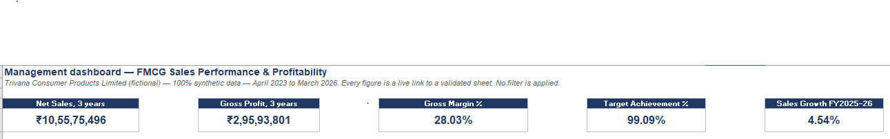
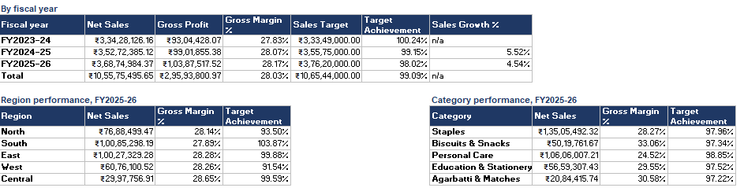
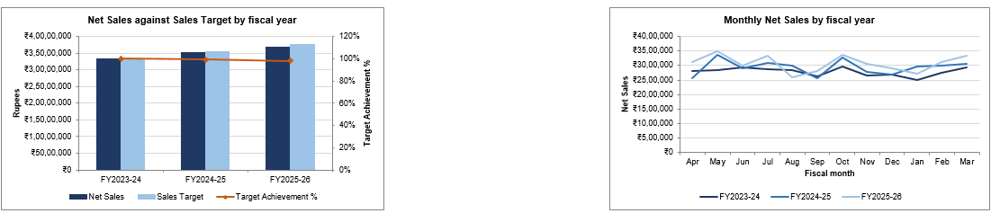
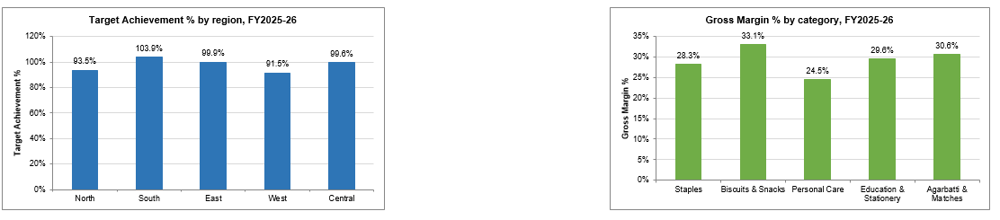

# FMCG Sales Analytics | Excel & Power Query

### Sales Performance, Profitability & Business Insights

## Project Overview

I built this project to understand how raw FMCG sales data can be cleaned, analysed, and transformed into useful business insights using Microsoft Excel and Power Query.

The project is based on **Trivana Consumer Products Limited**, a fictional FMCG company, with synthetic sales data covering **April 2023 to March 2026**.

My focus was to analyse sales trends, profitability, regional and product category performance, and actual sales against business targets. I also developed an Excel dashboard to present the findings in a clear and practical way.

## Project at a Glance

| Project Detail | Information |
|---|---|
| Industry | FMCG |
| Analysis Period | April 2023 – March 2026 |
| Raw Sales Records | 60,261 |
| Cleaned Sales Records | 60,033 |
| Tools | Microsoft Excel, Power Query |
| Key Skills | Data Cleaning, Data Validation, PivotTables, Advanced Excel, Dashboard Reporting |
| Dataset | 100% Synthetic |

## Business Objectives

The project focuses on answering five key business questions:

- How have sales and profitability changed over three financial years?
- Which regions and product categories contribute the most to revenue?
- How does actual sales performance compare with planned targets?
- What is the impact of discounts on sales and profitability?
- Which business areas show opportunities for improvement?

## Tools & Techniques

**Microsoft Excel**
- Advanced Excel formulas, including SUMIFS and SUMPRODUCT
- PivotTables and PivotCharts
- KPI calculations and financial analysis
- Dashboard development and data visualisation

**Power Query**
- Data import and transformation
- Data cleaning and standardisation
- Duplicate and missing-value handling
- Data quality checks and validation
- Combining sales data with master datasets

## Data Cleaning & Validation

I worked with 60,261 raw sales records and prepared a cleaned dataset of 60,033 records.

The cleaning process involved identifying duplicate records, handling missing or inconsistent values, checking data types, and validating records against product, customer, and geography master data.

I also built data quality checks to reconcile record counts and financial metrics, helping make the analysis more reliable.

## Dashboard & Key KPIs

I developed an Excel dashboard to track overall sales performance and compare results across financial years, regions, and product categories.

| KPI | Overall Result |
|---|---:|
| Gross Sales | ₹11.05 Cr |
| Net Sales | ₹10.56 Cr |
| Gross Profit | ₹2.96 Cr |
| Gross Margin | 28.03% |
| Sales Target | ₹10.65 Cr |
| Target Achievement | 99.09% |
| Units Sold | 17,59,980 |

The dashboard includes annual sales comparisons, monthly sales trends, regional and category performance, profitability, and target achievement.

## Key Business Insights

**1. Consistent sales growth**

Net sales increased across all three financial years, from approximately ₹3.34 Cr in FY2023–24 to ₹3.69 Cr in FY2025–26.

**2. Stable profitability**

The business maintained an overall gross margin of 28.03%, with a gradual improvement across the analysis period.

**3. Sales targets need closer monitoring**

Overall target achievement was 99.09%. While revenue increased, annual target achievement declined from 100.24% in FY2023–24 to 98.02% in FY2025–26.

**4. Regional performance varied**

The South region exceeded its FY2025–26 sales target, while other regions showed different levels of achievement.

**5. Category-level analysis supports better decisions**

Comparing category sales, margins, and target achievement helps identify where the business is performing well and where further attention may be needed.

## Project Structure

The Excel workbook includes:

- **Dashboard** – Overall business performance and visual reporting
- **KPI_Summary** – Sales, profitability, and target calculations
- **Sales_Clean** – Prepared sales dataset
- **Target_vs_Actual** – Actual sales compared with planned targets
- **PivotTable Analysis** – Performance breakdowns across business dimensions
- **Data Quality Checks** – Validation and reconciliation of results

## How to Explore

Open the Excel workbook and start with the **Dashboard** sheet for a quick overview.

For detailed calculations, review **KPI_Summary**. The PivotTable analysis sheets provide additional breakdowns, while the Power Query queries and validation sheets show how the data was prepared and checked.

## Project Note

This is an independent portfolio project created to demonstrate practical Excel, Power Query, and business analytics skills.

**All company information and sales data used in this project are fictional and synthetic.** No confidential or real customer data has been used.

## Dashboard Preview

### Key Performance Indicators

### Sales Performance Analysis

### Sales Trends and Target Analysis

### Additional Business Insights

